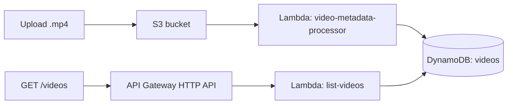
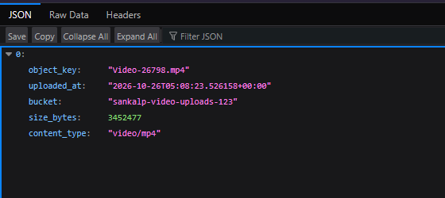
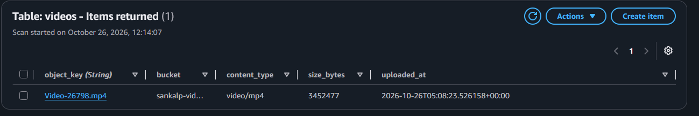
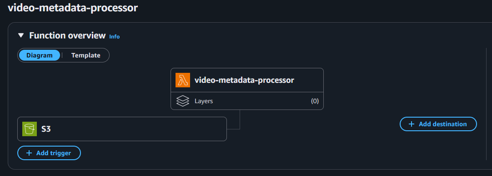

# Serverless Video Metadata Pipeline (AWS)

An event-driven pipeline on AWS. Uploading an `.mp4` to S3 triggers a Python Lambda function that stores the file's metadata in DynamoDB. A serverless HTTP API returns the stored records as JSON.

## Architecture



## How it works

1. A video is uploaded to the S3 bucket.
2. The S3 event notification (object created, suffix `.mp4`) triggers `video-metadata-processor`.
3. The function reads the object's size and content type with `head_object` and writes a record to the `videos` DynamoDB table.
4. `GET /videos` on the API Gateway HTTP API invokes `list-videos`, which scans the table and returns the records as JSON.

## Services used

S3, Lambda (Python 3.12, boto3), DynamoDB, API Gateway (HTTP API), IAM, CloudWatch

## Repository structure

```
.
├── lambda/
│   ├── video_metadata_processor.py   # S3 trigger: writes metadata to DynamoDB
│   └── list_videos.py                # API handler: returns stored records
├── iam/
│   ├── video-processor-policy.json   # s3:GetObject + dynamodb:PutItem
│   └── list-videos-policy.json       # dynamodb:Scan
└── docs/                             # screenshots
```

The account ID in the IAM policies is replaced with `YOUR-ACCOUNT-ID`.

## Design decisions

- **Lambda with an S3 event trigger:** no servers to manage, and it scales with the number of uploads.
- **DynamoDB on-demand capacity:** traffic is low and unpredictable, so paying per request fits better than provisioning capacity.
- **HTTP API instead of REST API:** cheaper and simpler, and enough for a single read endpoint.
- **Least-privilege IAM:** each function gets only the exact actions it needs on one bucket or one table (see `iam/`).
- **`Scan` for listing:** fine for a small demo table. At scale I would use `Query` with a proper key design and pagination.
- **`default=int` in `json.dumps`:** DynamoDB returns numbers as `Decimal`, which the JSON encoder cannot serialise.

## Troubleshooting notes

- The first test run failed with a 403 on `HeadObject`. CloudWatch Logs showed the error, and the cause was the IAM policy's S3 resource ARN missing the bucket name. Correcting the ARN fixed it.
- Opening the API's base URL returned `Not Found`. The route is `GET /videos`, so the path has to be included.

## Output

### API response (`GET /videos`)


### DynamoDB table


### S3 trigger on the Lambda function


## Possible improvements

- Thumbnail generation using an ffmpeg Lambda layer
- Infrastructure as code with Terraform
- Authentication on the API
- Pagination for the list endpoint
